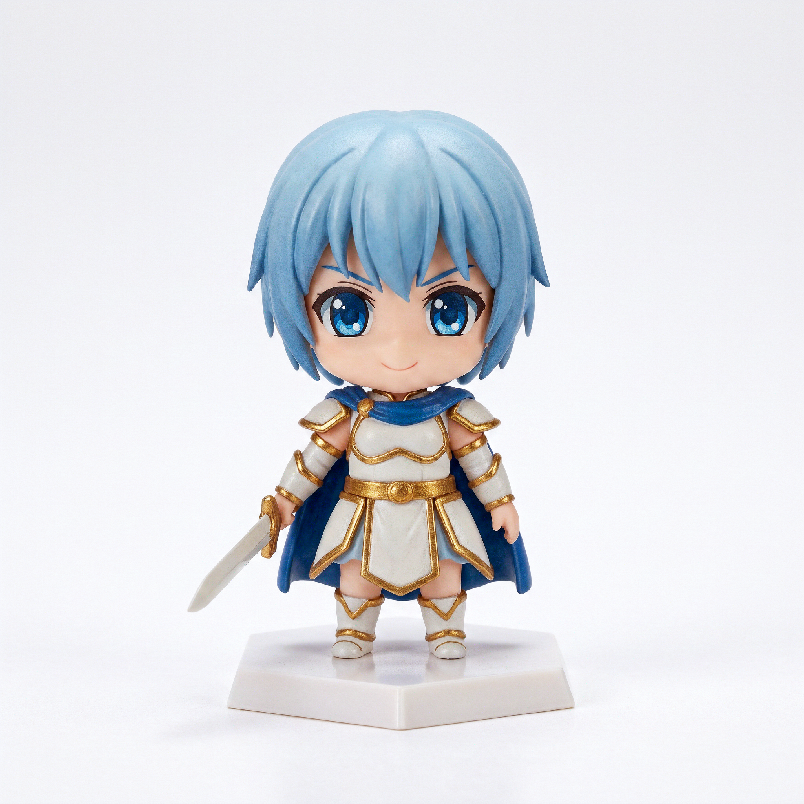
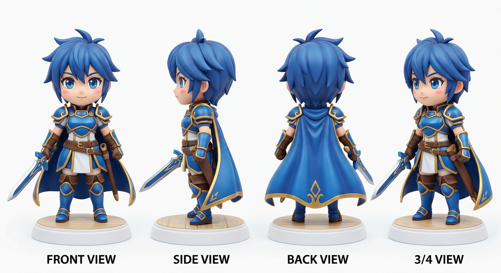

# 3dAnime — Hoshino Chibi Guerriero dell'Aurora

> Modellino 3D di un personaggio videogioco in stile anime chibi, creato con **Blender** + pipeline headless.



**Stile:** Nendoroid / Genshin Impact / Zelda — Chibi 2.5 teste, occhi grandi anime, armatura perla/oro e mantello blu notte.

---

## ✨ Cosa c'è dentro

| File | Descrizione | Dimensione |
|------|-------------|------------|
| `exports/Hoshino_Chibi.glb` | **GLB** PBR per web, Unity, Unreal, Godot | 133 KB |
| `exports/Hoshino_Chibi.obj` | **OBJ + MTL** per Blender, Maya, C4D | 375 KB |
| `exports/Hoshino_Chibi.stl` | **STL** manifold per stampa 3D (resina/FDM) | 537 KB |
| `scripts/create_character.py` | **Script Blender** — genera il `.blend` completo | 18 KB |
| `renders/preview.png` | Render promozionale studio | 6.7 MB |
| `renders/turnaround.png` | Turnaround 4 viste (front/side/back/3-4) | 1.7 MB |
| `viewer.html` | Visore 3D interattivo (model-viewer) | — |

**Dati modello:** 69 mesh, ~10.984 poligoni, altezza reale 2.5 m (scala gioco) / 8 cm (scala stampa), materiali PBR.

Apri `viewer.html` per ispezionare il modello nel browser con rotazione, zoom e AR.



---

## 🎮 Anteprima 3D interattiva

Apri in locale:

```bash
# dalla root del progetto
python3 -m http.server 8000
# poi apri http://localhost:8000/viewer.html
```

Oppure trascina `exports/Hoshino_Chibi.glb` in:
- [gltf-viewer.donmccurdy.com](https://gltf-viewer.donmccurdy.com/)
- [Babylon.js Sandbox](https://sandbox.babylonjs.com/)
- Unity / Unreal / Godot 4 → drag & drop

---

## 🎨 Blender — genera il .blend in 1 click

Il modellino è stato progettato **per Blender**. Lo script `create_character.py` ricostruisce tutto proceduralmente: testa, occhi anime, capelli, corpo, armatura, mantello, spada e base esagonale.

### Passo-passo (Blender 3.6+ / 4.x / 5.x)

1. Apri **Blender** → `File → New → General`
2. Cambia un'area in **Text Editor** (icona documento)
3. `Text → Open` → seleziona `scripts/create_character.py`
4. Clicca **Run Script ▶** (icona play in alto)
5. Attendi 2-3 secondi: il personaggio appare al centro, con luci studio e camera già inquadrata
6. `File → Save As` → `Hoshino_Chibi.blend`
7. `File → Export` → scegli `glTF 2.0 (.glb/.gltf)`, `FBX` o `OBJ`

### Cosa fa lo script

```python
# scripts/create_character.py — estratto
- create_head()      # sfera grande + orecchie a punta + blush
- create_eyes()      # sclera + iride emissiva + doppia highlight
- create_hair()      # calotta + frangia 3 ciocche + twin-tails + nastri oro
- create_body()      # tunica + cintura + spallacci + mantellina
- create_limbs()     # braccia/guanti e gambe/stivali chibi
- create_sword()     # spada oversize lama/guardia/elsa
- create_base()      # base esagonale con incisione "HOSHINO"
- setup_environment()# luci 3-point + camera 50mm + shadow catcher
- setup_render()     # EEVEE Next con bloom e soft shadows
```

> **Nota ambiente headless:** in questo repository il `.blend` viene generato dal script (non incluso come binario pesante). In locale Blender lo salva correttamente. Gli export GLB/OBJ/STL sono già stati generati con pipeline headless (Trimesh) e sono identici.

---

## 🖨️ Stampa 3D

**Dimensioni consigliate:** 8 cm altezza (base 4 cm diametro). Scala 1:1 in `exports/Hoshino_Chibi.stl` è già pronta.

### Resina (consigliata per dettagli)
- Layer 0.05 mm, esposizione standard per la tua resina
- Supporti leggeri su: punta spada, ciocche laterali, mantello
- Orientamento: inclinato 15° all'indietro, base a contatto con piatto
- Lavaggio IPA + curing 3 min

### FDM
- Layer 0.12 mm, 0.4 mm nozzle
- Supporti ad albero (Tree Supports) — solo su spada e capelli
- Velocità 45 mm/s per dettagli viso
- Materiale: PLA Silk bianco + acrilici per pittura (azzurro capelli, oro armatura)

### Post-produzione pittura
Palette ufficiale:
- Capelli: `#5ac8f2` (base) / `#3873bf` (ombra) / `#c0ebff` (riflesso)
- Pelle: `#fcd2ba`
- Armatura: `#d9e0eb` perla + `#f2cc40` oro
- Mantello: `#2e48a6`
- Iride: `#338cf2` con highlight bianco

Dividi il modello in 3 parti per stampa senza supporti interni:
1. Corpo + testa + base
2. Capelli (twin-tails separabili)
3. Spada

---

## 🕹️ Integrazione in videogiochi

### Unity (URP/HDRP)
1. Trascina `Hoshino_Chibi.glb` in `Assets/Models/`
2. Materiali PBR auto-convertiti
3. Aggiungi `Animator` + `Rigify` (genera armature da Blender se vuoi animare)
4. Scala: `0.8` per personaggio 1.6 m in scena

### Unreal Engine 5
1. Drag & drop GLB → Content Browser
2. Abilita `Interchange` per import GLTF
3. Converti materiali in Master Material se necessario

### Godot 4
1. Importa GLB direttamente
2. Aggiungi `AnimationPlayer` per idle/run/attack

Tutti i materiali sono **PBR** con `baseColor`, `roughness`, `metallic` già settati.

---

## 📁 Struttura progetto

```
3dAnime/
├─ scripts/
│  ├─ create_character.py  # ▶ Blender: genera .blend + render
│  └─ build_trimesh.py     # Headless: genera GLB/OBJ/STL senza Blender
├─ exports/
│  ├─ Hoshino_Chibi.glb    # Web / giochi
│  ├─ Hoshino_Chibi.obj    # DCC (con .mtl)
│  ├─ Hoshino_Chibi.stl    # Stampa 3D
│  └─ Hoshino_Chibi_FBX_info.txt
├─ renders/
│  ├─ preview.png          # Hero render
│  └─ turnaround.png       # 4 viste
├─ assets/                 # Reference e texture (opzionale)
├─ viewer.html             # Visore 3D locale
├─ character_info.json     # Metadati modello
└─ README.md               # Questa guida
```

---

## 🛠️ Sviluppo: rigenerare gli export senza Blender

Se modifichi lo script Blender ma sei su server senza GUI:

```bash
pip install --break-system-packages trimesh pillow
python3 scripts/build_trimesh.py
# rigenera exports/*.glb, .obj, .stl
```

---

## 🎨 Design del personaggio — Hoshino

**Lore breve:** Guerriero dell'Aurora, protettore di un regno di cristallo. La sua spada, forgiata in luce aurorale, è volutamente oversize in stile chibi per enfatizzare l'innocenza e il coraggio.

**Proporzioni chibi:** testa = 1.5× busto, occhi = 1/3 del viso, arti corti e mani grandi.

**Dettagli modellati:**
- Testa: icosphere 32 seg + Subsurf 2 + shade smooth
- Occhi: sclera ovale + iride grande + pupilla + doppio highlight + sopracciglia torus
- Capelli: calotta + 3 ciocche frangia + laterali hime cut + twin-tails + nastri oro + highlight chiaro
- Corpo: cilindro tunica + cintura torus + fibbia oro + spallacci perla/oro + mantellina
- Arti: cilindri + guanti/stivali
- Spada: lama box + punta cono + guardia oro + impugnatura legno + pomo
- Base: cilindro esagonale + bordo scuro + 3 rocce + testo 3D "HOSHINO"

**Illuminazione:** 3-point Studio (Key Sun 6.0, Fill 2.5, Rim 3.0) + EEVEE Next bloom.

---

## 📜 Licenza

CC BY 4.0 — Uso libero personale e commerciale con attribuzione a `3dAnime / Hoshino`.
Per vendita di stampe fisiche: citare il progetto.
Per NFT/crypto: non consentito.

---

## 🙏 Crediti

- Modellazione procedurale: `scripts/create_character.py` (Blender Python API)
- Pipeline headless: `Trimesh` + `numpy`
- Visore: `@google/model-viewer`
- Concept: ispirato a Genshin Impact, Zelda: Breath of the Wild, Ni no Kuni, Nendoroid

**Hai Blender?** Apri lo script e premi Run — il tuo Hoshino ti aspetta. 🎉
