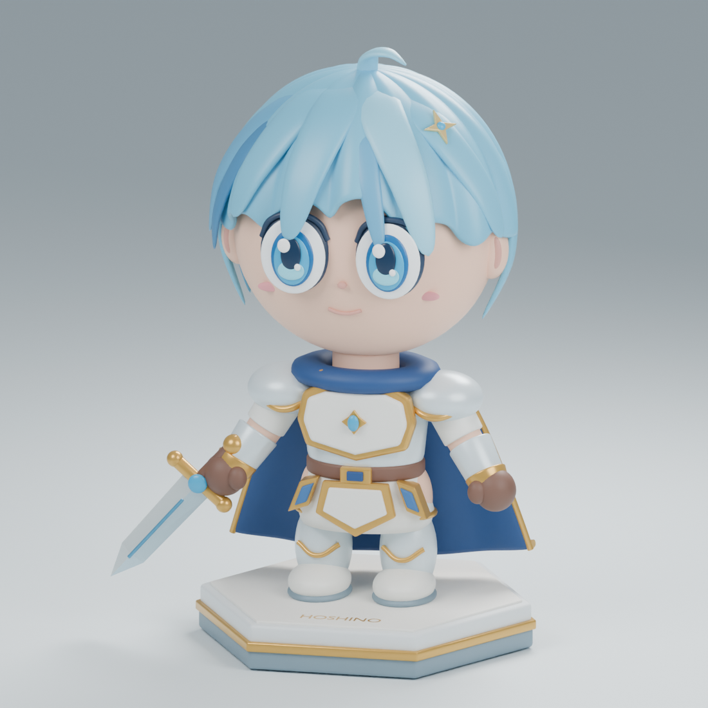
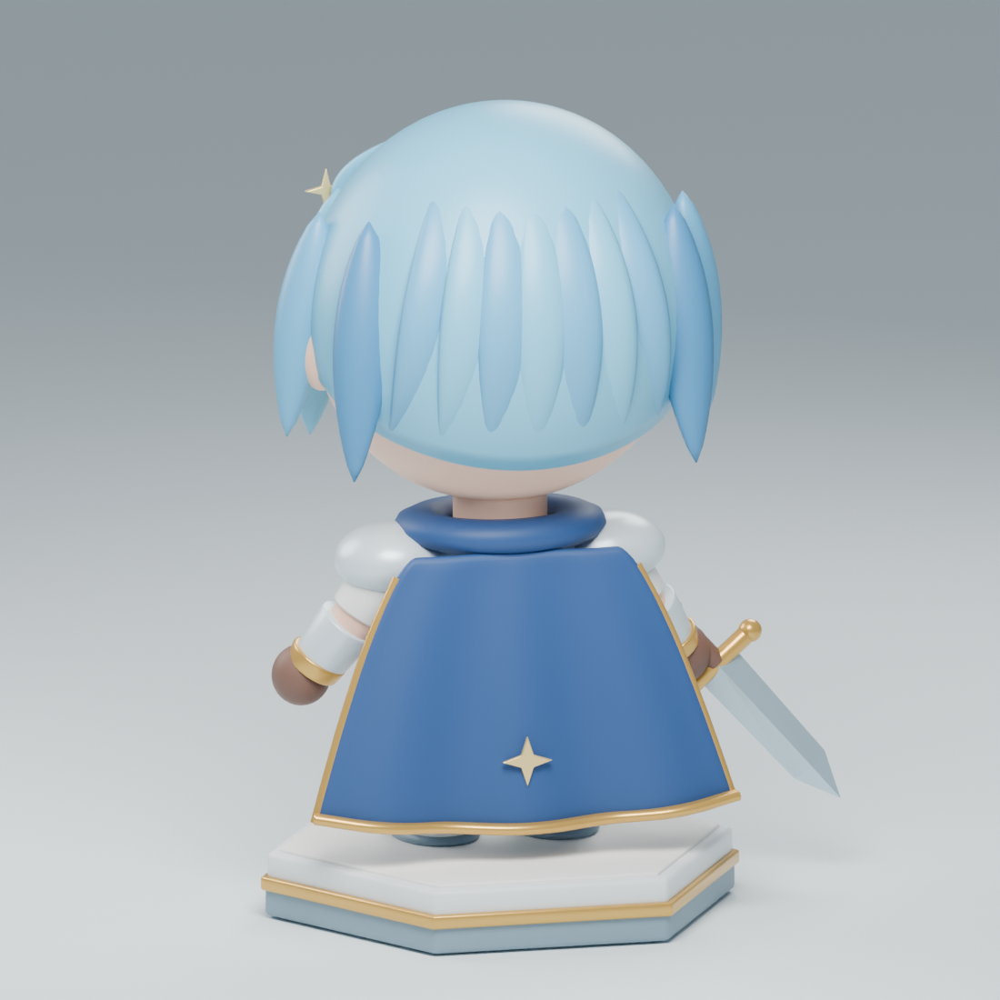

# Hoshino — il guerriero dell'aurora

Una statuetta 3D anime/chibi con capelli azzurri, armatura perla e oro, mantello blu e spada. Questa versione rinnova il personaggio e il visore: il viso è finalmente visibile, i capelli sono modellati a ciocche e i dettagli sono presenti anche sul retro.



*Questo è un render della scena 3D inclusa nel repository, non un'immagine di concept.*

## Esplora il modello

Avvia un piccolo server dalla cartella del progetto:

```bash
python3 -m http.server 8000
```

Apri **http://localhost:8000/** oppure `viewer.html` attraverso il server. Il visore funziona con un browser moderno e WebGL: trascina per ruotare, usa la rotella o il pinch per ingrandire, oppure scegli Fronte, Lato e Retro. Il pulsante Rotazione avvia o ferma la rotazione automatica; i pulsanti + e − regolano lo zoom, Schermo intero amplia il visore dove supportato e Ripristina riporta alla vista iniziale. Nella sezione dettagli puoi anche alternare i render frontale e posteriore. Libreria e font sono inclusi localmente, quindi non è necessario un CDN.



## File disponibili

| File | Contenuto |
| --- | --- |
| [`Hoshino_Chibi.blend`](exports/Hoshino_Chibi.blend) | Scena Blender modificabile, con materiali, luci e camera |
| [`Hoshino_Chibi.glb`](exports/Hoshino_Chibi.glb) | Modello a colori con materiali PBR, per web e motori 3D |
| [`Hoshino_Chibi_OBJ.zip`](exports/Hoshino_Chibi_OBJ.zip) | OBJ e relativo MTL insieme, per software di modellazione |
| [`Hoshino_Chibi.stl`](exports/Hoshino_Chibi.stl) | Volume unico, alto **80 mm**, per la preparazione alla stampa |
| [`create_character.py`](scripts/create_character.py) | Sorgente procedurale della scena Blender |

Anche l'[OBJ](exports/Hoshino_Chibi.obj) e il suo [MTL](exports/Hoshino_Chibi.mtl) sono disponibili separatamente: vanno tenuti nella stessa cartella. Per FBX apri il `.blend` e usa l'export di Blender.

Il modello a colori contiene **119 oggetti mesh e 105.666 triangoli**. È statico, **non riggato e non animato**. I file GLB e OBJ usano la scala della scena Blender (altezza 3,82 unità); lo STL viene invece esportato in millimetri, con altezza 80 mm. Il pavimento e le luci dello studio non sono inclusi negli export del personaggio.

## Aprire o modificare in Blender

1. Apri `exports/Hoshino_Chibi.blend` in **Blender 4.2 o successivo**.
2. La collezione `HOSHINO - modello` contiene le parti del personaggio; la collezione `STUDIO` contiene camera, luci e pavimento.
3. Modifica gli oggetti o i materiali, salva una copia e riesporta nel formato desiderato.

Per ricostruire la scena dall'inizio, apri `scripts/create_character.py` nel Text Editor di Blender e premi **Run Script**. Senza argomenti lo script crea la scena, ma non sovrascrive i file: salvala manualmente se desideri conservarla. Vedi la [guida Blender](docs/BLENDER_GUIDA.md).

### Rigenerare tutti gli export

Dalla cartella del progetto, con Blender 4.2+ installato:

```bash
blender --background --python scripts/create_character.py -- --export --render --save-blend
python3 -m pip install -r requirements-model.txt
python3 scripts/prepare_stl.py
```

Il primo comando ricrea GLB, OBJ/MTL, ZIP, STL, i due render effettivi e il `.blend`. Il secondo script esegue l'unione booleana dei componenti dello STL e ne controlla il risultato. **Ogni nuovo `--export` riscrive lo STL con i componenti originali sovrapposti: riesegui `prepare_stl.py` prima di distribuirlo o inviarlo allo slicer.** Per render di prova più rapidi aggiungi `--quick` alle opzioni dello script Blender.

Il vecchio `scripts/build_trimesh.py` è conservato come generatore **legacy** della prima versione approssimata; scrive in `exports/legacy/` e non ricrea il modello aggiornato.

Per verificare gli export e i collegamenti locali del visore, dopo aver installato `requirements-model.txt`:

```bash
python3 -m unittest discover -s tests -v
```

## Stampa 3D

Lo STL fornito è un unico volume chiuso, verificato dopo l'unione, senza il pavimento dello studio. Questo non garantisce automaticamente una buona stampa: a 80 mm ciglia, bordi e punta della spada sono molto sottili. Aprilo nello slicer, controlla eventuali zone fragili e aggiungi supporti dove necessario; valuta una scala maggiore o una modifica degli spessori. La resina è più adatta ai dettagli fini rispetto a un ugello FDM standard. Leggi la [guida alla stampa](docs/STAMPA_3D.md).

## Immagini di concept precedenti

Le immagini originali [`renders/preview.png`](renders/preview.png) e [`renders/turnaround.png`](renders/turnaround.png) sono mantenute come riferimenti visivi: **non rappresentano esattamente la geometria degli export**. Per vedere il modello reale usa i nuovi render qui sopra o il visore.

## Licenza e crediti

Il progetto originale indica **CC BY 4.0 con attribuzione a `3dAnime / Hoshino`** e riportava anche una limitazione su NFT/crypto; quest'ultima non fa parte dei termini standard CC BY 4.0, quindi va chiarita con il titolare prima di fare affidamento su tale combinazione.

Visore: [model-viewer](https://modelviewer.dev/) (licenza inclusa in `assets/vendor/`). Font Manrope e Cormorant Garamond: licenze incluse in `assets/fonts/`.
